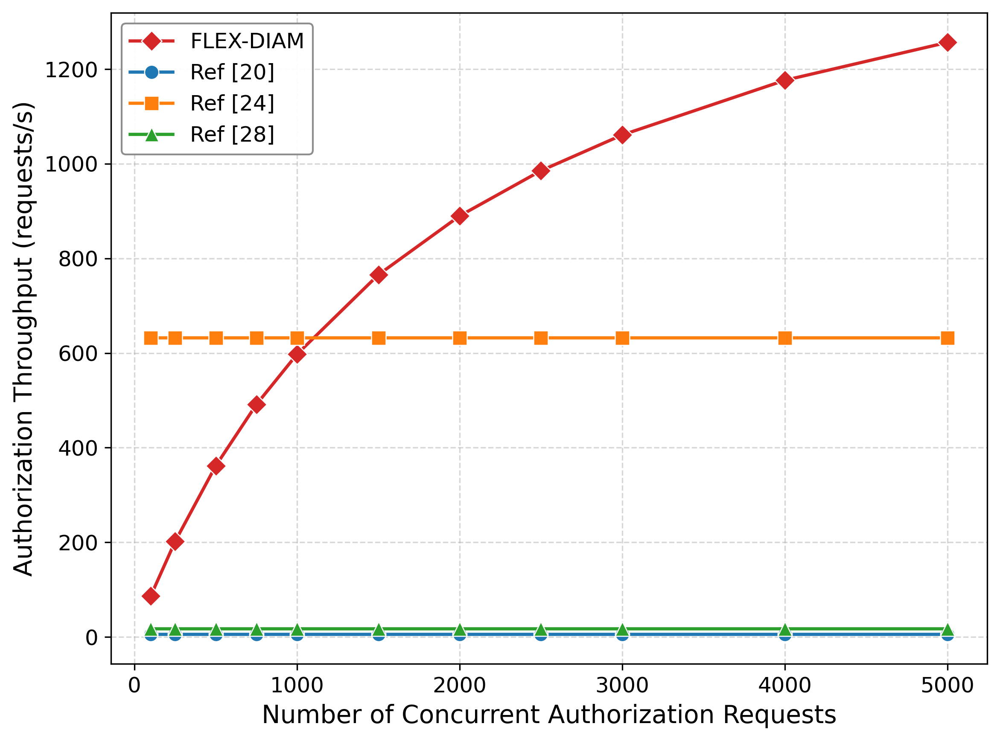
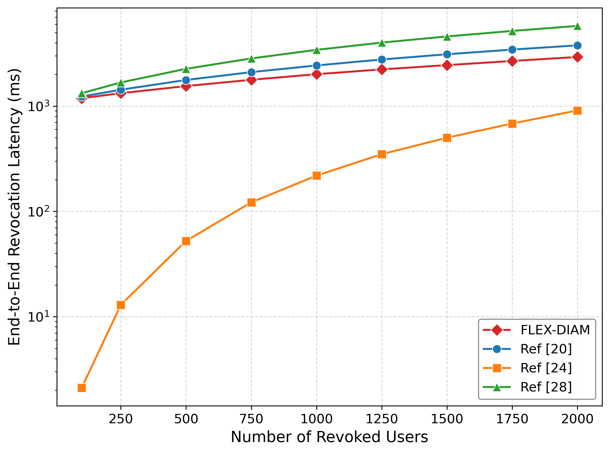
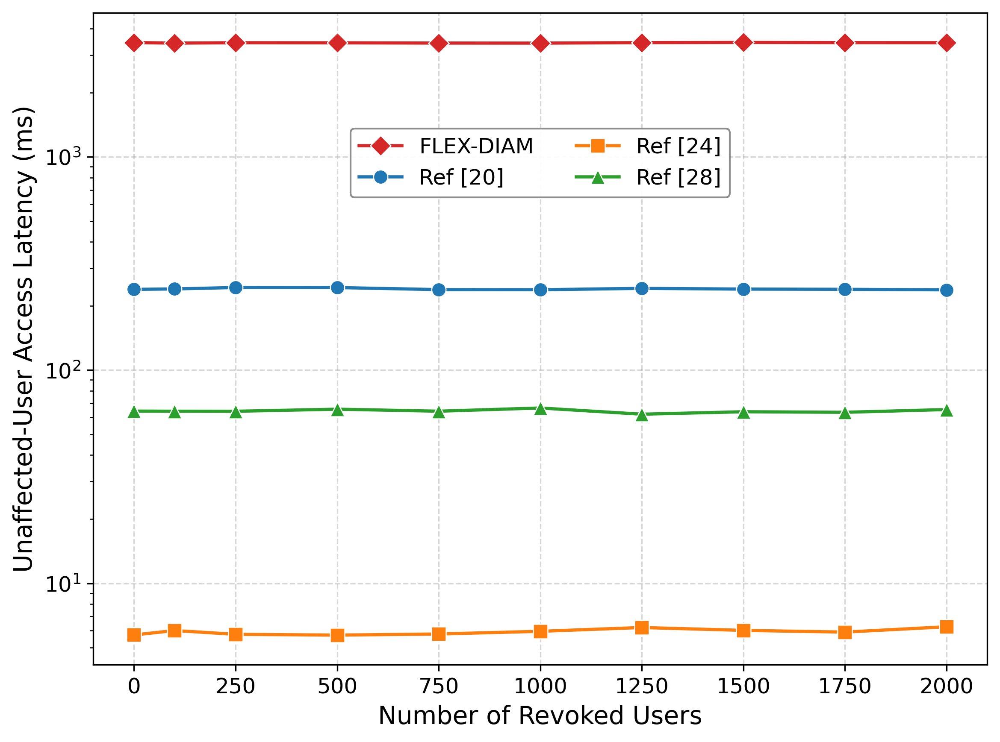

# FLEX-DIAM V3 — implementation and experiment report

Prototype and measurements for *FLEX-DIAM: Flexible Cross-Domain Identity and
Access Management with Selective Revocation for IoMT-EHR Sharing*
(scoped-revocation revision, October 2026).

Report date: 2026-10-12. Repository: `Flex_diam_ehr_v3`.

## Contents

1. [Summary](#1-summary)
2. [Background and scope](#2-background-and-scope)
3. [Architecture of the prototype](#3-architecture-of-the-prototype)
4. [Implementation](#4-implementation)
5. [Compared schemes](#5-compared-schemes)
6. [Baseline audit and corrections](#6-baseline-audit-and-corrections)
7. [Experimental setup](#7-experimental-setup)
8. [Experiments: definition and method](#8-experiments-definition-and-method)
9. [Results](#9-results)
10. [Validation](#10-validation)
11. [Limitations](#11-limitations)
12. [Reproducing](#12-reproducing)
13. [Chronology](#13-chronology)
14. [Data and file inventory](#14-data-and-file-inventory)

---

## 1. Summary

**What was built.** A working prototype of the FLEX-DIAM protocol as the revised
paper specifies it: Phases 1–5 with scoped revocation versions, a Groth16
authorization proof for the paper's relation, Fiat–Shamir batch verification, a
context-bound ABPRE over BSW07 CP-ABE, and a Go chaincode on Hyperledger Fabric
holding the DID registry, the scoped revocation state and the audit anchors.
Three experiments compare it with Refs [20] (Zeng et al.), [24] (Li et al.,
SRAA) and [28] (Wang et al., CAMS).

**What was measured.** All three experiments were run on 2026-10-11 with 30
independent runs each (Run 1). After that run the baseline models of Refs [20]
and [24] were audited against their source papers and corrected (§6). A re-run
with the corrected baselines (Run 2) was started on 2026-10-12; §9.1 says which
numbers are final.

**Findings that do not depend on the baseline corrections** (FLEX-DIAM and Ref
[28] are unchanged by them):

| Experiment | Result for FLEX-DIAM (Run 1, mean of 30 runs) |
|---|---|
| 1 — authorization throughput | 86.7 requests/s at 100 concurrent requests, 1,256.5 at 5,000. Above Ref [28] (16.8) at every load. Above Ref [24] (632.3) from about 1,100 concurrent requests upward; below it at lower loads. |
| 2 — scoped user revocation | 1,187.5 ms for 100 revoked users, 2,928.9 ms for 2,000: one blockchain commit (≈ 1,095 ms) plus 0.91 ms per revoked user. Below Ref [28] at every workload (by 10.5 % to 49.3 %). |
| 3 — unaffected-user access | 3,428 ms, independent of the number of revoked users (slope +4.3 ms per 1,000 revoked users, 95 % CI −4.6 to +13.2). The same CP-ABE key, credential and ciphertext were used throughout; a token issued before a revocation workload was still accepted afterwards in 270 of 270 checks. FLEX-DIAM's latency is the highest of the four schemes; 63 % of it is two synchronous audit commits and 24 % is proof generation. |

**Validation.** The protocol passes 12 functional checks on the live Fabric
network (authorized access, continuity for unaffected users, rejection of revoked
users at three points, context binding of the transformed key, proof soundness
checks, policy- and domain-scope revocation). The baseline implementations pass
4 self-checks. Details in §10.

---

## 2. Background and scope

### 2.1 The revision this code follows

Earlier versions of the scheme used one global revocation epoch: every
revocation advanced the epoch and thereby invalidated every outstanding token
and delegation certificate in the system. The revised paper replaces the epoch
with **scoped revocation state**

```
RS = ⟨RL, {v_D}, {v_p}, {v_H}⟩
```

one version per doctor (v_D), per policy (v_p) and per healthcare domain (v_H),
plus the revocation list RL. A request is bound to the versions that concern it:

```
σ_i = ⟨v_Di, v_pid, v_Hs, v_Hd⟩
ρ_i = H(DID_Di ‖ DID_Hs ‖ DID_Hd ‖ cid ‖ pid ‖ σ_i)
```

Authorization tokens and delegation certificates carry ρ_i. Revoking doctor D_i
adds DID_Di to RL and increments only v_Di, so only artifacts whose ρ contains
v_Di become stale.

### 2.2 What changed from the previous code base (V2)

| Area | V2 | V3 |
|---|---|---|
| Revocation state | global epoch counter + revocation list | per-user, per-policy, per-domain versions + revocation list; no shared key |
| Protocol layer | separate primitives, epoch-bound DAC | Phases 1–5 end to end, ρ-bound token and DAC, context ctx, three audit commitments |
| ZKP circuit | Poseidon commitment + epoch equality, ~240 constraints, 2 public signals | the paper's relation (policy satisfaction, credential signature, DID binding), 3,810 constraints, public input ⟨DID, pid, ρ⟩ |
| Batch verifier | random 128-bit coefficients | Fiat–Shamir coefficients of eq. 25, recursive partition on failure, `verify` mode for live proofs |
| ABPRE | CP-ABE plus a separate ElGamal re-encryption of a second key encapsulation | one CP-ABE key ciphertext CT_k, transformed under a context-bound key issued by the KMS |
| Experiment 2 | one transaction advancing the epoch; per-user maintenance of all users charged to the baselines | real scoped revocation of N doctors; the revoking authority's cost only |
| Experiment 3 | total maintenance over all users | end-to-end access latency of one unaffected doctor |
| Baselines | cost-dominant operation models | Ref [20] signature and Ref [24] revocation phase implemented in full and self-checked (§6) |

### 2.3 Scope

The prototype implements the protocol logic and the cryptography completely
enough that every validation predicate of the paper is evaluated on real data
and every measured operation is really executed. It is not a deployable system:
all roles run in one process on one machine (§11).

---

## 3. Architecture of the prototype

```
                         ┌─────────────────────────────────────────────┐
                         │  Hyperledger Fabric 2.5.9 (test-network)    │
                         │  chaincode "flexv3" (Go, as a service)      │
                         │  DID registry · RL · v_D / v_p / v_H        │
                         │  metadata ⟨Meta, Com⟩ · audit anchors       │
                         └───────────────▲─────────────────────────────┘
                                         │ peer CLI (submit→commit / query)
┌────────────────────────────────────────┴────────────────────────────────────┐
│  flex_diam/protocol.py  (one Python process, all roles)                     │
│                                                                             │
│  Doctor ── Req ──▶ Authorization service ──▶ Delegation service ──▶ KMS     │
│    │   proof π        resolve σ, ρ             Valid_del, DAC       ReKeyGen │
│    │                  BatchVerify, AuthTok     DelCom audit            │     │
│    │                  BatchCom audit                                   ▼     │
│    ◀──── release of ⟨CT'_k, ctx, DAC⟩ ◀── Cloud ◀── Proxy gateway (ReEnc)   │
└───────┬───────────────────────┬─────────────────────────┬──────────────────┘
        │                       │                         │
  SnarkJS (Groth16 prove)  batchverify_native (Go)   Charm-Crypto (BSW07,
  Circom circuit           gnark-crypto BN254         pairings on BN254)
```

| Component | Technology | Files |
|---|---|---|
| Protocol, all roles | Python 3.10 | `flex_diam/protocol.py` |
| Ledger client | `peer` CLI subprocesses; in-memory mirror for offline tests | `flex_diam/chain.py` |
| Smart contract | Go, fabric-contract-api-go 1.2.2, chaincode-as-a-service | `chaincode/flex/` |
| CP-ABE / ABPRE | Charm-Crypto 0.63 on PBC 0.5.14, curve BN254 | `flex_diam/abpre.py` |
| Proof generation | Circom 2.1.9 circuit, SnarkJS 0.7.6 Groth16 (alt_bn128) | `zkp/authz_template.circom`, `flex_diam/zkp.py` |
| Batch verification | Go, gnark-crypto 0.20.1 | `zkp/batchverify_native/main.go` |
| Signatures, AEAD | `cryptography` (OpenSSL): ECDSA P-256, ChaCha20-Poly1305 | `flex_diam/protocol.py` |

---

## 4. Implementation

The equation-level map from the paper to functions is in
[PAPER_FIDELITY.md](PAPER_FIDELITY.md) §1. This section describes each part.

### 4.1 Identities and hashing

- Every entity (patient, doctor, hospital) has an ECDSA P-256 key pair.
  `DID_E = "did:flex:" + first 128 bits of SHA-256(pk_E)`, registered on chain
  with pk_E (eq. 2–3).
- `H(a ‖ b ‖ …)` is SHA-256 over an unambiguous encoding: each component is
  prefixed with its 4-byte length (`flex_diam/hashing.py`).
- Values that enter the circuit are mapped to the BN254 scalar field by taking
  the first 31 bytes of a SHA-256 digest (248 bits).

### 4.2 Chaincode

State is a set of independent keys; there is no key that every revocation
writes, so revocations of different users never conflict.

| Key prefix | Content | Paper |
|---|---|---|
| `did_<DID>` | verification key | eq. 3 |
| `rl_<DID>` | membership in RL | eq. 7 |
| `vd_<DID>`, `vp_<pid>`, `vh_<DID_H>` | scoped versions; an absent key reads as 0 | eq. 7 |
| `meta_<cid>` | ⟨cid, DID_P, DID_H, pid, Com⟩ | eq. 13–14 |
| `batch_<bid>` | ⟨BatchCom, t_batch⟩ | eq. 30 |
| `del_<DelCom>`, `acc_<AccCom>` | delegation and access audit records | eq. 42, 49 |
| `anchor_<key>` | generic one-key anchor used to calibrate chain units | — |

| Function | Kind | Effect |
|---|---|---|
| `RegisterDID`, `RegisterDIDs`, `GetDID` | write / write / read | DID registry; the plural form registers a batch in one transaction (setup only) |
| `RegisterMetadata`, `GetMetadata` | write / read | ciphertext metadata and audit commitment |
| `RevokeUser(did)` | write | RL ← RL ∪ {did}; v_D ← v_D + 1 (eq. 50) |
| `RevokeUsers(dids)` | write | eq. 50 applied to every listed doctor in one transaction; each doctor gets its own RL entry and its own version increment |
| `RevokeDomain(did_H)` | write | RL ← RL ∪ {did_H}; v_H ← v_H + 1 |
| `RevokePolicy(pid)` | write | v_p ← v_p + 1 |
| `ResolveState(DID_D, DID_Hs, DID_Hd, cid, pid)` | read | returns σ = ⟨v_D, v_p, v_Hs, v_Hd⟩, RL membership of the three entities, and the registered pid_CT in one query |
| `AnchorBatch`, `RecordDelegation`, `RecordAccess` | write | audit anchors |
| `Anchor`, `GetAnchor` | write / read | one-key write and read for unit calibration |

`flex_diam/chain.py` wraps these. `FabricLedger` calls the `peer` binary: a write
is `peer chaincode invoke … --waitForEvent` against both organizations' peers and
is timed from submission to commit; a read is `peer chaincode query`.
`MemoryLedger` mirrors the contract in a dictionary and is used only by the
offline functional test; the experiment drivers refuse to run on it.

### 4.3 EHR encryption (Phase 2)

- `K_AES` is 256 random bits (eq. 8). The EHR is encrypted with
  ChaCha20-Poly1305 (eq. 9).
- BSW07 encrypts a GT element, so K_AES is carried as a hybrid encapsulation:
  `CT_k = ⟨BSW07.Enc(PK, R, A), K_AES ⊕ KDF(R), kc = H("kc" ‖ K_AES)⟩` with a
  random R ∈ GT (eq. 11). The confirmation tag kc lets decryption return ⊥.
- `pid = Poseidon(Encode(A))`, where Encode(A) is the sorted list of the
  policy's attributes as field elements (eq. 10). Poseidon is used here so that
  the circuit can check the opening of pid.
- `Com = H(cid ‖ DID_P ‖ DID_H ‖ pid ‖ H(CT))` and the metadata are anchored on
  chain (eq. 13–14).

### 4.4 Context-bound ABPRE (Phase 4)

The paper fixes the interfaces `ReKeyGen(MSK, pk_Hd, ctx)`,
`ReEnc(rk, CT_k, ctx)` and `ReDec(SK_D, CT'_k, ctx)` and requires that
decryption under any other context returns ⊥. The instantiation
(`flex_diam/abpre.py`):

```
ReKeyGen(MSK, pk_Hd, ctx):                       (run by the KMS)
    SK*  ← BSW07.KeyGen(MSK, attributes of A)
    Z    ←$ GT ;  z = H_Zr(Z ‖ ctx ‖ pk_Hd)
    TK   = SK*^(1/z)                             every component raised to 1/z
    HDR  ← BSW07.Enc(PK, Z, A)
    rk   = ⟨TK, HDR, pk_Hd⟩

ReEnc(rk, CT_k, ctx):                            (run by the proxy)
    Q    = partial BSW07 decryption of CT_k with TK  =  e(g,g)^(α·s/z)
    CT'_k = ⟨C̃, Q, HDR, wrap, kc, pk_Hd, τ = H("tau" ‖ ctx ‖ Q)⟩

ReDec(SK_D, CT'_k, ctx):                         (run by the doctor)
    reject if τ ≠ H("tau" ‖ ctx ‖ Q)
    Z    ← BSW07.Dec(SK_D, HDR)                  ⊥ if Attr_D does not satisfy A
    z    = H_Zr(Z ‖ ctx ‖ pk_Hd)
    R    = C̃ / Q^z ;  K_AES = wrap ⊕ KDF(R) ;  ⊥ if H("kc" ‖ K_AES) ≠ kc
```

Properties, each exercised by `smoke_protocol.py`:

- Correctness under the right context (check 1, 2).
- ⊥ under a different context, also when the tag τ is recomputed for the wrong
  context: the blinding factor z itself depends on ctx (check 6).
- ⊥ for a key whose attributes do not satisfy A (check 6).
- The proxy holds only the blinded key TK and never obtains R or K_AES; only the
  encrypted key component is transformed.

This is the transformation-key technique of outsourced CP-ABE decryption applied
with a context-derived blinding factor. No security proof is claimed for it.

Measured cost (Run 1, net of the blockchain read made in the same step):
ReKeyGen ≈ 26 ms, ReEnc ≈ 108 ms, ReDec plus AEAD decryption ≈ 118 ms.

### 4.5 Credentials and the authorization proof (Phase 3 Steps 1–3)

- The credential issuer signs `m = Poseidon(Attr_D, DID_D, t_exp)` with
  EdDSA-Poseidon on Baby-Jubjub: `VC_D = (R8, S)` (eq. 5).
- The circuit (`zkp/authz_template.circom`) proves the paper's relation (eq. 22)
  for public input `x = ⟨DID_D, pid, ρ⟩` (eq. 19) and private witness
  `w = ⟨Attr_D, VC_D⟩` (eq. 20):

| Clause of eq. 22 | In the circuit |
|---|---|
| Verify_pkCI(VC_D) = 1 | `EdDSAPoseidonVerifier` on m, with pk_CI a constant of the circuit |
| DID(VC_D) = DID_D | the public `did` is hashed into m, so a credential issued to another DID does not verify |
| A(Attr_D) = 1 | `pid === Poseidon(req)` opens the policy; every non-zero required attribute must equal one of the credential's attributes |
| binding to ρ | ρ is a public input constrained in the circuit |

| Circuit figure | Value |
|---|---|
| Constraints | 3,810 |
| Wires | 3,817 |
| Public inputs | 3 |
| Private inputs | 12 (4 attributes, t_exp, 3 signature values, 4 policy slots) |
| Powers of tau | 2^13 |

- The issuer and the data owner need exactly the circuit's Poseidon and
  Baby-Jubjub arithmetic to sign a credential and to compute pid. They obtain it
  by evaluating a witness-only helper circuit (`zkp/oracle.circom`) through its
  witness calculator, so there is no second implementation of either primitive
  that could disagree with the circuit.
- Proof generation is `snarkjs groth16 fullprove` (witness and proof in one Node
  process). Measured: 812 ms per proof including Node start-up (Run 1).
- The authorization service derives the expected public inputs itself from the
  request and its own ρ and rejects a proof whose public signals differ. A
  credential presented under another DID is rejected at this point (check 8).

### 4.6 Batch verification (Phase 3 Step 4)

`zkp/batchverify_native/main.go` implements eq. 23–26:

```
η_B ←$ {0,1}^256                         sampled after the batch is closed
r_i = SHA-256(η_B ‖ bid ‖ i ‖ x_i ‖ π_i) mod p,  forced non-zero
Valid_B :  ∏_i e(−r_i·A_i, B_i) · e(Σ r_i·L_i, γ) · e(Σ r_i·C_i, δ)
                                 · e((Σ r_i)·α, β) = 1
```

where L_i is the public-input combination of proof i. This is one pairing check
over b + 3 pairs with a single final exponentiation, in place of b separate
4-pair checks. If the check fails, the batch is halved recursively until the
invalid proofs are isolated; single proofs are verified individually. G1 points
are checked to be on the curve and G2 points to be in the subgroup before use.

Modes: `verify <bid> <proof> <public> …` (used by the protocol for live proofs),
`bench batch|individual <b> <reps>` (Experiment 1), `selftest`.

### 4.7 Tokens, certificates, context and audit commitments

| Object | Definition | Paper |
|---|---|---|
| AuthTok_i | ECDSA signature by sk_SC over ⟨DID_Di, DID_Hs, DID_Hd, cid, pid, ρ_i, t_exp⟩ | eq. 28 |
| BatchCom | H(bid ‖ H(AuthTok_i) for every accepted request), anchored with t_batch | eq. 29–30 |
| DAC_i | ECDSA signature by sk_SC over ⟨DID_Di, DID_Hs, DID_Hd, cid, pid, ρ_cur, t_del⟩, t_del ≤ t_exp | eq. 35 |
| ctx_i | H(DID_Di ‖ DID_Hs ‖ DID_Hd ‖ cid ‖ pid ‖ ρ_cur ‖ H(DAC_i)) | eq. 36, 46 |
| DelCom_i | H(request fields ‖ ρ_cur ‖ H(DAC_i) ‖ H(AuthTok_i)), recorded with t_del | eq. 42 |
| AccCom_i | H(request fields ‖ ρ_cur ‖ H(AuthTok_i) ‖ H(DAC_i) ‖ t_acc) | eq. 49 |

Validation predicates are implemented clause by clause: `valid_rev` (eq. 18),
`valid_del` (eq. 34) and `valid_acc` (eq. 45). Lifetimes: t_exp = now + 600 s,
t_del = min(now + 120 s, t_exp).

### 4.8 The end-to-end access path

`FlexDiam.access()` runs the path that Experiment 3 measures. Each role that the
paper says validates the current scoped state performs its own blockchain read.
Times are Run 1 means over 300 accesses.

| Step | Role | Work | Chain | Mean (ms) |
|---|---|---|---|---:|
| P3 S1 | authorization service | resolve σ_i, compute ρ_i | 1 read | 57.9 |
| P3 S2 | authorization service | Valid_rev | — | 0.0 |
| P3 S3 | doctor | Groth16 proof | — | 811.6 |
| P3 S4 | authorization service | BatchVerify (b = 1), compare public inputs | — | 3.7 |
| P3 S5 | authorization service | sign AuthTok | — | 0.2 |
| P3 S6 | authorization service | anchor BatchCom | 1 write | 1,086.3 |
| P4 S2 | delegation service | resolve σ_cur, Valid_del | 1 read | 63.5 |
| P4 S3 | delegation service | sign DAC | — | 0.1 |
| P4 S4 | KMS | check DAC against current state, ctx, ReKeyGen | 1 read | 86.4 |
| P4 S5 | proxy | check DAC against current state, ReEnc | 1 read | 167.7 |
| P4 S6 | delegation service | record DelCom | 1 write | 1,087.1 |
| P5 S1 | cloud | resolve σ_cur, Valid_acc, release | 1 read | 63.5 |
| | | **clock stops: transformed key material released** | **5 reads, 2 writes** | **3,427.9** |
| P5 S2–3 | doctor | ctx*, ReDec, AEAD decryption | — | 118.0 |
| P5 S4 | cloud | record AccCom | 1 write | 1,088.1 |

### 4.9 Revocation

`revoke_user`, `revoke_users`, `revoke_policy` and `revoke_domain` call the
chaincode functions of §4.2. A revocation changes only the keys of its scope.
The functional test confirms the three scopes separately (checks 2–5 and 10).

---

## 5. Compared schemes

All three run on the same pairing library and curve as FLEX-DIAM (Charm-Crypto,
BN254) on the same machine.

### 5.1 Ref [20] — Zeng et al., IEEE TIFS 2025

Group signature with a dynamic accumulator. `baselines/zeng.py` implements the
scheme's algorithms with real keys:

| Algorithm | Operations | Used in |
|---|---|---|
| Sign | 8 G1 and 2 G2 scalar multiplications, 2 pairings, 2 GT exponentiations, hash | Exp 3 (device side) |
| Verify | 7 G1 scalar multiplications, 3 pairings, 3 GT exponentiations, hash; the accumulator value enters inside the third pairing | Exp 1, Exp 3 |
| Revoke | ACC ← (s + x)⁻¹·ACC: one inversion and one G2 scalar multiplication per revoked device | Exp 2 |
| Update | w = ∏(s_j + x) over the N revocations since the user's last update, W_i ← w·W_i: N field multiplications and one G2 scalar multiplication | Exp 3 |

The verifier reads the latest accumulator value from the blockchain; that read
is charged in Experiments 1 and 3.

### 5.2 Ref [24] — Li et al., IEEE TII 2026 (SRAA)

Authentication with a symmetric bivariate polynomial f(x, y) of degree t = 100;
each twin holds the slice g_i(y) = f(PID_i, y). SRAA has no blockchain.
`baselines/li.py` implements:

| Part | Operations | Used in |
|---|---|---|
| Authentication, server side | degree-100 slice evaluation, chameleon-hash reconstruction (2 scalar multiplications), hashes | Exp 1, Exp 3 |
| Authentication, twin side | 3–4 scalar multiplications, 2 hashes | Exp 3 |
| Revocation, gateway | u ←$; Φ(θ) = ∏(θ − MID_i); expansion of Ψ(θ) = u·Φ(θ) + f(θ, Φ(θ)); f ← u·f | Exp 2 |
| Revocation, twin | evaluate Φ and Ψ at PID_i, u = (Ψ(PID_i) − g_i(Φ(PID_i)))/Φ(PID_i), g_i ← u·g_i | Exp 3 |

The revocation phase runs on a real polynomial: a legitimate twin recovers the
gateway's u and ends with the slice of the new polynomial, and a revoked twin
(Φ(PID) = 0) cannot update. The authentication parts are operation-count models.

### 5.3 Ref [28] — Wang et al., IEEE TCSS 2024 (CAMS)

Certificateless authentication on a primary–secondary blockchain with
chameleon-hash revocation. `baselines/wang.py` is an operation-count model built
from the cost formulas of that paper:

| Part | Operations | Used in |
|---|---|---|
| Authentication, server side | certificateless verification: scalar multiplications, hash, point additions | Exp 1, Exp 3 |
| Authentication, client side | 6 scalar multiplications, 4 hashes, 3 point additions | Exp 3 |
| Revocation | chameleon-hash forge: 3 scalar multiplications, 1 hash, 1 point addition per revoked identity | Exp 2 |
| After revocation | none for other users; the verifier queries the on-chain blacklist | Exp 3 |

### 5.4 Blockchain operations charged to the baselines

The baselines' own blockchain steps are charged as a count times a unit measured
live on the same Fabric network at the start of every run (`chain_meter`: 20
one-key writes and 20 one-key reads). FLEX-DIAM's blockchain operations are never
modelled: they are executed.

| Experiment | Ref [20] | Ref [24] | Ref [28] | FLEX-DIAM |
|---|---|---|---|---|
| 1, per request | 1 read (accumulator value) | none | 1 read (blacklist / registration) | none per request; 1 write per verification window (batch anchor) |
| 2, per workload | 1 write (new accumulator value published) | none | 1 write (revocation broadcast) | executed: 1 transaction |
| 3, per access | 1 read, executed | none | 1 read, executed | executed: 5 reads, 2 writes |

---

## 6. Baseline audit and corrections

After Run 1 the three baseline models were checked line by line against the
source papers. Two did not match and were corrected on 2026-10-12. Run 1 was
measured before the corrections.

### 6.1 Ref [20]: an operation that is not in the scheme

The earlier model added a separate accumulator membership check (one G2 scalar
multiplication and two pairings, measured at 44.9 ms) to every signature
verification. In Zeng's scheme the accumulator value is used inside the
verification equation itself, and the cross-domain protocol has no further
membership check. The check was removed, and Sign and Verify were rewritten to
follow the paper exactly, with a signature that really verifies (it is rejected
for another message and against a changed accumulator value).

Effect: Ref [20] becomes faster in Experiments 1 and 3. Offline timing after the
correction: Sign ≈ 62 ms, Verify ≈ 80 ms. Its Experiment 2 cost (accumulator
updates) was already as the paper defines it and did not change.

### 6.2 Ref [24]: two omitted operations, and the grouping of revocations

The earlier model built Φ and multiplied it by u, but did not expand
f(θ, Φ(θ)) on the gateway side and did not evaluate Ψ on the twin side. Both are
required: a twin does not know f, so Ψ has to be broadcast in expanded form, and
the twin must evaluate it at its own identity to recover u.

With f of degree t in each variable, a round that revokes m twins produces a Ψ
with t·(m+1)+1 coefficients, and expanding it by Horner's rule in Φ costs about
t²·m²/2 field operations. The cost therefore depends strongly on how a workload
of N revocations is grouped into update rounds:

| Grouping | Gateway, N = 100 | One twin, N = 100 |
|---|---:|---:|
| 1 revoked twin per round | 0.80 s (8.0 ms per round) | 8.4 ms (84 µs per round) |
| 2 per round | 0.76 s | 6.5 ms |
| 5 per round | 1.11 s | 3.3 ms |
| 20 per round | 3.26 s | 2.4 ms |
| all N in one round | ≈ 16 s (extrapolated) | ≈ 2.5 ms |

(Offline timings on the reference machine. The last gateway value is
extrapolated by exact operation count from measured rounds of 5, 10 and 20; at
N = 2,000 a single round would take roughly 6,200 s in this harness.)

Small rounds favour the gateway, large rounds favour the twins, and no grouping
is best for both. The experiments use **one round per revoked twin**
(`SRAA_BATCH=1`): it is close to the cheapest grouping for the gateway, it is how
Refs [20] and [28] are charged (per revocation), and it is applied identically
in Experiments 2 and 3. Other groupings can be measured by setting `SRAA_BATCH`.

Two further facts about this baseline:

- The unit cost in this harness is about 0.27–0.31 µs per field
  multiply-and-add. SRAA's own paper reports 0.060 ms for one degree-100
  polynomial evaluation, about 0.6 µs per operation, so the harness is not
  slower than the source's own figure.
- SRAA states that the number of twins in a domain is bounded by t. With
  t = 100, workloads of up to 2,000 revoked users are outside the range the
  scheme was designed for.

### 6.3 Which Run 1 numbers the corrections affect

| Experiment | Ref [20] | Ref [24] | Ref [28] | FLEX-DIAM |
|---|---|---|---|---|
| 1 | superseded (verification model changed) | unaffected | unaffected | unaffected |
| 2 | unaffected | superseded (gateway expansion added) | unaffected | unaffected |
| 3 | superseded | superseded (twin evaluation added) | unaffected | unaffected |

Superseded columns are marked † in §9.

---

## 7. Experimental setup

### 7.1 Machine and software

| Item | Value |
|---|---|
| CPU | Intel Core i5-10400F, 6 cores / 12 threads, 2.9 GHz |
| Memory | 16 GB (WSL2 sees 7 GiB) |
| Host OS | Windows 11 Pro 10.0.26200 |
| Guest OS | Ubuntu 22.04.5 LTS under WSL2, kernel 6.18.33.1 |
| Docker | 29.5.3 (Docker Desktop, WSL integration) |
| Python | 3.10.12 |
| Charm-Crypto / PBC | 0.63 / 0.5.14 |
| `cryptography` / `matplotlib` | 49.0.0 / 3.10.9 |
| Node.js / SnarkJS / Circom / circomlib | 18.20.8 / 0.7.6 / 2.1.9 / 2.0.5 |
| Go | 1.22.5; the verifier is built with a Go 1.25 toolchain (gnark-crypto 0.20.1) |
| Hyperledger Fabric | 2.5.9 binaries and images; fabric-samples commit `119d3bc` |
| Pairing curve (CP-ABE, ABPRE, baselines) | BN254 as provided by Charm-Crypto / PBC |
| Proof system | Groth16 over alt_bn128 (SnarkJS `bn128`) |

### 7.2 Fabric network

| Parameter | Value |
|---|---|
| Topology | test-network: 2 peer organizations (1 peer each), 1 orderer |
| Ordering service | etcdraft |
| State database | LevelDB |
| Channel | `mychannel` |
| BatchTimeout | 1 s |
| MaxMessageCount / AbsoluteMaxBytes / PreferredMaxBytes | 10 / 99 MB / 512 KB |
| Chaincode | `flexv3`, chaincode-as-a-service, sequence 1, endorsed by both organizations |

Measured units across the 30 runs of Experiment 2 (Run 1): one write
(submission to commit) 1,095.2 ms on average, between 1,085.7 and 1,120.4 ms per
run. One read takes about 56–60 ms, most of it start-up of the `peer` process.

### 7.3 Measurement method

- Timing uses `time.perf_counter_ns()` around the real operation. For
  subprocesses (SnarkJS, the verifier, `peer`) the wall-clock time of the whole
  process is taken, so process start-up is included.
- A **run** is one complete execution of a driver: it calibrates the chain
  units, creates fresh keys and identities, and measures every point of the
  grid. `repeat_expN.sh` performs 30 runs and `average_csvs.py` writes the
  per-cell mean and population standard deviation over the runs.
- In Experiments 2 and 3 each run contributes one measurement per point
  (`TRIALS=1`), so every reported cell is the mean of 30 independent
  measurements. Experiment 1 additionally averages 30 crypto samples per
  baseline and takes the median of 3 batch verifications inside each run.
- Nothing is simulated or scaled except the baselines' blockchain steps
  (§5.4), which are a count times a unit measured in the same run.
- `plot_figs.py` only reads the CSV files.

---

## 8. Experiments: definition and method

### 8.1 Experiment 1 — authorization throughput (Fig. 2)

*Question.* How many authorization requests per second can the verifier side
complete when R requests arrive together, R from 100 to 5,000?

*Model.* A single-threaded authorization server drains the burst;
throughput = R / (time to authorize all R). Proof or signature generation is on
the requester's device for every scheme and is not part of the server's time.

| Scheme | Time for a burst of R requests |
|---|---|
| Ref [20] | R × (Verify + 1 chain read) |
| Ref [24] | R × (server-side authentication) |
| Ref [28] | R × (certificateless verification + 1 chain read) |
| FLEX-DIAM | BatchVerify(R) + R × token signature + 1 chain write (batch anchor) |

*Measurement.* The baselines' per-request crypto is the mean of 30 live samples.
FLEX-DIAM's BatchVerify(R) is executed for real at every R on a corpus of 32
distinct real proofs (different doctors, credentials and ρ) repeated cyclically
to fill the batch; the median of 3 executions is used. The token signature unit
is measured over 500 signatures. Because a baseline's per-request cost does not
depend on R, its throughput is the same at every R.

*Grid.* R ∈ {100, 250, 500, 750, 1,000, 1,500, 2,000, 2,500, 3,000, 4,000, 5,000}.

### 8.2 Experiment 2 — scoped user revocation overhead (Fig. 3)

*Question.* How long does it take to revoke N users, including the blockchain
confirmation, N from 100 to 2,000? Maintenance by users who are *not* revoked is
excluded here and measured in Experiment 3.

| Scheme | What is executed and timed |
|---|---|
| FLEX-DIAM | N fresh doctor identities are registered (not timed), then revoked by one `RevokeUsers` transaction that gives each its RL entry and its version increment. Timed from submission to commit. |
| Ref [20] | N accumulator updates, executed; plus 1 chain write unit. |
| Ref [24] | N gateway update rounds (Φ, expansion of Ψ, f ← u·f), executed on a real polynomial; no blockchain. |
| Ref [28] | N chameleon-hash forges, executed; plus 1 chain write unit. |

*Convention.* A workload is confirmed on chain once for every scheme that uses a
blockchain. `REVOKE_MODE=per_tx` measures FLEX-DIAM with one transaction per
doctor instead.

*Grid.* N ∈ {100, 250, 500, 750, 1,000, 1,250, 1,500, 1,750, 2,000}.

### 8.3 Experiment 3 — unaffected-user continuity after revocation (Fig. 4)

*Question.* After N other users have been revoked, how long does one
non-revoked doctor D_j need to access an unchanged EHR, N from 0 to 2,000?

*Setup, once per run and not timed.* Ten hospital DIDs, one patient, D_j with
its credential and CP-ABE key, and one encrypted EHR with its on-chain metadata.
D_j's key, credential and the ciphertext are never changed afterwards.

*For each N, cumulatively on the real ledger.* The driver registers and revokes
enough new doctors to bring the count to N, then measures:

| Scheme | What is executed and timed |
|---|---|
| FLEX-DIAM | `FlexDiam.access()`: the path of §4.8 from request submission to release of the transformed key material. Afterwards D_j decrypts and the plaintext is compared with the original. |
| Ref [20] | D_j's evidence update for N revocations + Sign + Verify + 1 chain read (executed). |
| Ref [24] | D_j's N update rounds + twin-side and server-side authentication. |
| Ref [28] | client-side + server-side authentication + 1 chain read (executed); no update. |

*Recorded with every workload.*

- `continuity_ok`: a token issued to D_j **before** the workload was revoked is
  used **after** it for delegation and release, and must be accepted.
- `revoked_rejected`: a doctor revoked in the workload must fail Valid_rev.

*Grid.* N ∈ {0, 100, 250, 500, 750, 1,000, 1,250, 1,500, 1,750, 2,000}.

---

## 9. Results

### 9.1 Status

| Run | Started | Baseline models | State |
|---|---|---|---|
| Run 1 | 2026-10-11 | as before the audit of §6 | complete: 30 runs of each experiment |
| Run 2 | 2026-10-12 00:14 | corrected (§6) | in progress when this report was written; not included below |

Run 1 values are means ± standard deviation over 30 independent runs. Columns
marked † were measured with a baseline model that has since been corrected and
will be replaced by Run 2. FLEX-DIAM and Ref [28] are not affected by the
corrections.

### 9.2 Experiment 1 — authorization throughput (requests/s), Run 1

| Concurrent requests R | Ref [20] † | Ref [24] | Ref [28] | FLEX-DIAM |
|---:|---:|---:|---:|---:|
| 100 | 5.6 ± 0.1 | 632.3 ± 22.1 | 16.8 ± 0.6 | 86.7 ± 0.4 |
| 250 | 5.6 ± 0.1 | 632.3 ± 22.1 | 16.8 ± 0.6 | 201.8 ± 0.8 |
| 500 | 5.6 ± 0.1 | 632.3 ± 22.1 | 16.8 ± 0.6 | 361.7 ± 1.6 |
| 750 | 5.6 ± 0.1 | 632.3 ± 22.1 | 16.8 ± 0.6 | 491.3 ± 2.0 |
| 1,000 | 5.6 ± 0.1 | 632.3 ± 22.1 | 16.8 ± 0.6 | 597.6 ± 6.2 |
| 1,500 | 5.6 ± 0.1 | 632.3 ± 22.1 | 16.8 ± 0.6 | 765.4 ± 5.6 |
| 2,000 | 5.6 ± 0.1 | 632.3 ± 22.1 | 16.8 ± 0.6 | 889.8 ± 6.2 |
| 2,500 | 5.6 ± 0.1 | 632.3 ± 22.1 | 16.8 ± 0.6 | 985.3 ± 7.1 |
| 3,000 | 5.6 ± 0.1 | 632.3 ± 22.1 | 16.8 ± 0.6 | 1,060.9 ± 7.1 |
| 4,000 | 5.6 ± 0.1 | 632.3 ± 22.1 | 16.8 ± 0.6 | 1,176.4 ± 10.4 |
| 5,000 | 5.6 ± 0.1 | 632.3 ± 22.1 | 16.8 ± 0.6 | 1,256.5 ± 8.6 |



Observations:

- FLEX-DIAM's throughput grows with the burst size because the one blockchain
  write per verification window (≈ 1,095 ms) is shared by all R requests. At
  R = 5,000 one request costs 0.796 ms in total: 0.219 ms is its share of the
  anchor and about 0.58 ms is batch verification plus the token signature.
- Refs [20] and [28] are bounded by one blockchain read per request (≈ 56 ms),
  which caps them near 17 requests/s regardless of their own cryptography.
- Ref [24] verifies locally in about 1.6 ms per request and has no blockchain
  step, giving a constant 632 requests/s.
- FLEX-DIAM is above Ref [28] at every R (5.2× at R = 100, 74.8× at R = 5,000).
  It is below Ref [24] for small bursts and crosses it at about R = 1,100,
  reaching 1.99× Ref [24] at R = 5,000.
- Compared with the same experiment on the V2 code
  (`results_v2_exp1/`), FLEX-DIAM is 1.5 % lower at R = 100 and 15.4 % lower at
  R = 5,000. The V3 proof has three public inputs instead of two and the
  verifier derives full-width Fiat–Shamir coefficients.

### 9.3 Experiment 2 — scoped user revocation latency (ms), Run 1

| Revoked users N | Ref [20] | Ref [24] † | Ref [28] | FLEX-DIAM |
|---:|---:|---:|---:|---:|
| 100 | 1,231.5 ± 11.2 | 2.1 ± 0.5 | 1,326.5 ± 10.4 | 1,187.5 ± 23.1 |
| 250 | 1,431.4 ± 10.3 | 12.9 ± 1.1 | 1,677.8 ± 12.6 | 1,327.0 ± 27.4 |
| 500 | 1,771.1 ± 13.3 | 52.4 ± 1.8 | 2,260.9 ± 17.0 | 1,549.9 ± 21.0 |
| 750 | 2,102.8 ± 19.5 | 121.8 ± 6.3 | 2,837.6 ± 18.9 | 1,778.8 ± 34.4 |
| 1,000 | 2,434.1 ± 13.4 | 218.6 ± 9.7 | 3,424.5 ± 29.9 | 2,010.1 ± 39.1 |
| 1,250 | 2,772.8 ± 21.6 | 349.4 ± 22.6 | 4,012.9 ± 35.3 | 2,233.7 ± 27.7 |
| 1,500 | 3,109.7 ± 26.1 | 500.9 ± 17.8 | 4,590.8 ± 45.9 | 2,450.2 ± 30.5 |
| 1,750 | 3,443.4 ± 33.6 | 683.4 ± 25.6 | 5,176.6 ± 51.9 | 2,685.1 ± 40.5 |
| 2,000 | 3,779.2 ± 24.4 | 909.1 ± 46.5 | 5,779.1 ± 81.2 | 2,928.9 ± 59.1 |



(In this figure the Ref [24] curve is the superseded one.)

Decomposition of the baselines (crypto executed; chain = unit measured in the
same run):

| N | Ref [20] crypto | Ref [20] chain | Ref [24] crypto † | Ref [28] crypto | Ref [28] chain |
|---:|---:|---:|---:|---:|---:|
| 100 | 136.3 | 1,095.2 | 2.1 | 231.2 | 1,095.2 |
| 250 | 336.1 | 1,095.2 | 12.9 | 582.6 | 1,095.2 |
| 500 | 675.9 | 1,095.2 | 52.4 | 1,165.7 | 1,095.2 |
| 750 | 1,007.6 | 1,095.2 | 121.8 | 1,742.3 | 1,095.2 |
| 1,000 | 1,338.9 | 1,095.2 | 218.6 | 2,329.3 | 1,095.2 |
| 1,250 | 1,677.6 | 1,095.2 | 349.4 | 2,917.7 | 1,095.2 |
| 1,500 | 2,014.5 | 1,095.2 | 500.9 | 3,495.6 | 1,095.2 |
| 1,750 | 2,348.2 | 1,095.2 | 683.4 | 4,081.4 | 1,095.2 |
| 2,000 | 2,683.9 | 1,095.2 | 909.1 | 4,683.9 | 1,095.2 |

Linear fits over the nine points:

| Scheme | Intercept (ms) | Per revoked user (ms) | R² |
|---|---:|---:|---:|
| FLEX-DIAM | 1,096.0 | 0.911 | 0.9999 |
| Ref [20] | 1,097.3 | 1.341 | 1.0000 |
| Ref [28] | 1,089.5 | 2.339 | 1.0000 |

Observations:

- The three schemes that confirm on a blockchain share the same floor, one
  commit of about 1,095 ms, and differ in what each revoked user adds:
  0.91 ms of chaincode state updates for FLEX-DIAM, 1.34 ms (one G2 scalar
  multiplication) for Ref [20], 2.34 ms (three scalar multiplications) for
  Ref [28].
- FLEX-DIAM is not constant in N: its latency grows 2.5× from 100 to 2,000
  users, because every revoked doctor gets its own list entry and its own
  version increment.
- FLEX-DIAM relative to Ref [20] and Ref [28]:

| N | vs Ref [20] | vs Ref [28] |
|---:|---:|---:|
| 100 | −3.6 % | −10.5 % |
| 500 | −12.5 % | −31.4 % |
| 1,000 | −17.4 % | −41.3 % |
| 2,000 | −22.5 % | −49.3 % |

- At N = 100 the margin over Ref [20] is 44 ms, about twice FLEX-DIAM's
  run-to-run standard deviation: FLEX-DIAM was below both Ref [20] and Ref [28]
  at every N in 27 of the 30 individual runs, and below both in the 30-run mean
  at every N.
- The Ref [24] column of Run 1 omits the expansion of Ψ (§6.2) and is not a
  valid basis for comparison. With one update round per revoked twin, the
  offline timing is about 8.0 ms per round, i.e. roughly 0.8 s at N = 100 and
  16 s at N = 2,000 (an estimate from offline timing, to be replaced by Run 2).

### 9.4 Experiment 3 — unaffected-user access latency (ms), Run 1

| Revoked users N | Ref [20] † | Ref [24] † | Ref [28] | FLEX-DIAM |
|---:|---:|---:|---:|---:|
| 0 | 239.2 ± 11.9 | 5.7 ± 1.4 | 64.2 ± 6.7 | 3,435.7 ± 55.0 |
| 100 | 240.3 ± 12.2 | 6.0 ± 1.7 | 64.2 ± 6.5 | 3,415.8 ± 36.5 |
| 250 | 244.1 ± 15.7 | 5.8 ± 0.7 | 64.1 ± 10.5 | 3,430.1 ± 41.7 |
| 500 | 243.9 ± 12.8 | 5.7 ± 0.6 | 65.6 ± 7.4 | 3,426.3 ± 36.6 |
| 750 | 238.6 ± 12.0 | 5.8 ± 1.1 | 64.2 ± 7.5 | 3,417.7 ± 41.3 |
| 1,000 | 238.3 ± 6.7 | 6.0 ± 0.6 | 66.4 ± 8.7 | 3,415.7 ± 41.7 |
| 1,250 | 241.8 ± 10.3 | 6.2 ± 2.0 | 62.1 ± 2.0 | 3,433.3 ± 64.8 |
| 1,500 | 239.9 ± 9.7 | 6.0 ± 1.1 | 63.8 ± 6.2 | 3,440.5 ± 77.9 |
| 1,750 | 239.3 ± 12.8 | 5.9 ± 0.2 | 63.4 ± 5.7 | 3,433.7 ± 50.7 |
| 2,000 | 237.9 ± 9.6 | 6.3 ± 1.4 | 65.3 ± 7.8 | 3,430.5 ± 56.3 |



(In this figure the Ref [20] and Ref [24] curves are the superseded ones.)

Dependence on the revocation workload, by ordinary least squares over all 300
(run, N) measurements of each scheme:

| Scheme | Mean (ms) | Slope (ms per 1,000 revoked users) | 95 % CI of the slope |
|---|---:|---:|---|
| FLEX-DIAM | 3,427.9 | +4.33 | −4.57 to +13.23 |
| Ref [28] | 64.4 | −0.16 | −1.40 to +1.08 |
| Ref [20] † | 240.3 | −1.34 | −3.33 to +0.66 |
| Ref [24] † | 5.9 | +0.19 | −0.02 to +0.39 |

Where FLEX-DIAM's time goes (means over the ten workloads; full table in §4.8):

| Part | Mean (ms) | Share of 3,428 ms |
|---|---:|---:|
| Two audit commits (batch anchor, delegation record) | 2,173.4 | 63.4 % |
| Proof generation | 811.6 | 23.7 % |
| Five scoped-state reads | 300.3 | 8.8 % |
| ReEnc and ReKeyGen, net of their reads | ≈ 134 | 3.9 % |
| Batch verification, signatures, validation | ≈ 4 | 0.1 % |

Baseline components (ms):

| N | Ref [20] update † | Ref [20] auth † | Ref [20] read | Ref [24] update † | Ref [24] auth | Ref [28] auth | Ref [28] read |
|---:|---:|---:|---:|---:|---:|---:|---:|
| 0 | 0.00 | 184.18 | 55.00 | 0.00 | 5.73 | 8.55 | 55.70 |
| 100 | 1.54 | 182.21 | 56.56 | 0.10 | 5.91 | 9.40 | 54.79 |
| 250 | 1.88 | 183.54 | 58.63 | 0.13 | 5.64 | 8.56 | 55.58 |
| 500 | 1.77 | 186.77 | 55.38 | 0.18 | 5.54 | 8.58 | 57.01 |
| 750 | 2.06 | 181.34 | 55.18 | 0.25 | 5.54 | 8.76 | 55.43 |
| 1,000 | 1.68 | 181.22 | 55.37 | 0.30 | 5.66 | 8.93 | 57.51 |
| 1,250 | 1.80 | 183.52 | 56.44 | 0.38 | 5.83 | 8.56 | 53.57 |
| 1,500 | 2.02 | 181.35 | 56.53 | 0.43 | 5.59 | 9.04 | 54.76 |
| 1,750 | 1.77 | 182.63 | 54.94 | 0.47 | 5.44 | 8.52 | 54.91 |
| 2,000 | 1.94 | 179.75 | 56.25 | 0.56 | 5.71 | 8.80 | 56.53 |

(The Ref [20] update values themselves follow Zeng's Update and are not affected
by the correction; the Ref [20] authentication includes the removed check. The
Ref [24] update values omit the evaluation of Ψ.)

Observations:

- **FLEX-DIAM does not depend on the revocation workload.** The ten cell means
  lie between 3,415.7 and 3,440.5 ms, a span of 24.8 ms (0.72 % of the mean),
  and the slope is not distinguishable from zero.
- **Continuity was checked directly.** At each of the 270 (run, N > 0) points, a
  token issued to D_j before the workload was revoked was accepted for
  delegation and release afterwards, and a doctor revoked in that workload was
  rejected. All 270 of each check succeeded. D_j's CP-ABE key, credential and
  the stored ciphertext were the same objects for the whole run, and the
  recovered plaintext matched the original in every one of the 300 timed
  accesses.
- **FLEX-DIAM has the highest absolute latency.** It performs a zero-knowledge
  authorization, a cross-domain key transformation and two on-chain audit
  records per access; the compared schemes perform one authentication. Ref [28]
  needs 64 ms, of which 56 ms is its blockchain read.
- **Ref [28] is also independent of the workload**: revoked identities sit in an
  on-chain blacklist and other users have nothing to update.
- **Ref [20]'s per-user update is small**, 1.5–2.1 ms for up to 2,000
  revocations, because the group manager aggregates all changes into one scalar
  before a single G2 scalar multiplication.
- **Ref [24] after the correction** (offline timing, to be replaced by Run 2):
  about 84 µs per update round, i.e. roughly 170 ms of update work at N = 2,000
  with one round per revoked twin, on top of 5.5 ms of authentication.

### 9.5 Run 2 — corrected baselines

Run 2 repeats all three experiments, 30 runs each, with the baseline
implementations of §6. It was started at 00:14 on 2026-10-12 and had not
finished when this report was written. Its results will be added under
`results/run2_2026-10-12/` and this section will be replaced by the final
tables.

Expected changes relative to Run 1, from offline timings only:

| Experiment | Ref [20] | Ref [24] |
|---|---|---|
| 1 | about 7 requests/s instead of 5.6 (Verify ≈ 80 ms, no separate check) | unchanged |
| 2 | unchanged | about 8 ms per revoked user: ≈ 0.8 s at N = 100, ≈ 16 s at N = 2,000 |
| 3 | about 200 ms instead of 240 ms | about 5.5 ms + 0.085 ms × N: ≈ 175 ms at N = 2,000 |

These are estimates, not results.

---

## 10. Validation

### 10.1 Functional checks of the protocol

`smoke_protocol.py` runs on the in-memory ledger (`--offline`) and on the live
Fabric network. Both end with `12/12 checks passed` (live run: 2026-10-11).

| # | Check | Paper property |
|---|---|---|
| 1 | An authorized cross-domain access recovers the EHR | correctness of Phases 3–5 |
| — | A batch of two valid requests yields two tokens under one audit anchor | eq. 23–30 |
| 2 | After another doctor is revoked, D_j's earlier token still authorizes delegation and release; ρ_j is unchanged | continuity for unaffected users |
| 3 | The revoked doctor is rejected by Valid_rev | eq. 18 |
| 4 | The revoked doctor's earlier token is rejected at delegation | eq. 34 |
| 5 | After a policy-scope revocation, old tokens are stale and a fresh authorization succeeds | policy scope |
| 6 | ReDec under a different context returns ⊥, also with a recomputed tag | eq. 39 |
| — | ReDec with a key that does not satisfy the policy returns ⊥ | CP-ABE enforcement |
| 7 | A credential lacking a required attribute cannot produce a proof | eq. 22 |
| 8 | A credential presented under another DID is rejected | DID(VC) = DID_D |
| 9 | A batch with one invalid request: recursive partition returns [valid, invalid, valid] | eq. 26 |
| 10 | After a domain-scope revocation, doctors of that domain are rejected | domain scope |

### 10.2 Checks inside the experiment

- Experiment 3: `continuity_ok` and `revoked_rejected` at every workload of
  every run (270 points each, all passed), and plaintext equality in every timed
  access (300, all passed).
- Experiment 3 performs one untimed warm-up access per run and aborts if the EHR
  is not recovered.

### 10.3 Components

| Component | Check | Result |
|---|---|---|
| Native verifier | `selftest`: all corpus proofs verify individually; valid batches of several sizes accepted; a corrupted public signal and a corrupted proof point are rejected; recursive partition isolates the corrupted request | PASS, for full-width and 128-bit coefficients |
| Circuits | compile; a witness exists only for a valid credential, the right DID and a satisfied policy | confirmed by checks 1, 7, 8 |
| Chaincode | `go build`, `go vet`, `gofmt`; deployed; `ResolveState` of an unknown request returns all-zero versions | confirmed on deployment, 2026-10-11 |
| Baselines | `python -m baselines.selftest`: Ref [20] signature verifies and is rejected for another message and for a changed accumulator; Ref [24] update factor recovered, revoked twin blocked | 4/4 offline, 2026-10-12 |
| Drivers | each driver was executed end to end on the in-memory ledger to check the code path and the CSV format; those outputs were discarded | confirmed |

### 10.4 Data integrity

- Every per-run CSV is kept (`results/<run>/runs/`): 30 per experiment, plus the
  per-run detail files of Experiments 2 and 3.
- The repeat scripts move earlier results into `results_archive/` before a new
  set of runs; nothing is overwritten.
- Pilot runs write to `*_PILOT.csv` and cannot be mistaken for results.

---

## 11. Limitations

**Environment**

- One machine, one process for all protocol roles; there is no network latency
  between roles. Fabric runs in local Docker containers under WSL2.
- Blockchain operations go through the `peer` command-line client. Each call
  starts a process, which accounts for most of the ≈ 56 ms of a read. A client
  using the Fabric SDK would be faster; the baselines' reads go through the same
  client.
- The commit latency is governed by the 1 s BatchTimeout of the ordering
  service. With a different timeout every on-chain write, and therefore the
  floor of Experiment 2 and 63 % of FLEX-DIAM's latency in Experiment 3, changes
  accordingly.
- Proof generation time includes starting Node.js for each proof.
- Pairings in Charm-Crypto's PBC backend are slow on BN254 (a Zeng verification
  with three pairings takes about 80 ms). This affects Ref [20] and FLEX-DIAM's
  ABPRE, not Refs [24] and [28].

**Modelling**

- Experiment 1 is a single-threaded server model. The baselines are charged one
  blockchain read per request; FLEX-DIAM is charged one write per verification
  window and no per-request read (PAPER_FIDELITY.md, note N1). Refs [20] and
  [28] are limited by that read rather than by their cryptography.
- In Experiment 3 the two audit records are committed synchronously before the
  access continues. No later validation depends on them; if they were recorded
  in the background, FLEX-DIAM's latency would be lower by about their commit
  time. That variant was not measured.
- The verification window Δ_b is zero in Experiment 3: a single request is
  verified immediately as a batch of one.
- One blockchain confirmation is charged per revocation workload for every
  scheme. Ref [20] and Ref [28] describe publication per revocation; charging N
  commits would add N × 1,095 ms to each.
- Ref [24]'s cost depends on the grouping of revocations into update rounds
  (§6.2). The default favours the gateway and disfavours the twins.
- Ref [28] and the authentication of Ref [24] are operation-count models built
  from the papers' cost formulas, not protocol implementations.
- Workloads above 100 twins per domain exceed SRAA's stated bound for t = 100.

**Prototype**

- No separate DID ledger; DIDs live on the Fabric chaincode. Credentials come
  from a local issuer whose key is fixed in the circuit at build time.
- The circuit supports conjunctive policies with up to four attributes and
  credentials with up to four attributes.
- Credential expiry is not checked inside the circuit.
- The ABPRE instantiation has no security proof.
- Forward revocation relies on the cloud and the proxy never releasing the
  stored CT_k directly: a revoked doctor still holds a CP-ABE key that satisfies
  the policy.
- Revoked identities accumulate on the ledger across runs. Lookups are keyed, so
  they are not on the measured path.
- The precondition checks at the top of the deployment script were added after
  the deployment that produced the results and have not been exercised on a
  live network.

---

## 12. Reproducing

Step-by-step commands are in [README.md](README.md). In outline:

1. `infra/setup_infra.sh` — toolchain and Fabric (once per machine).
2. `setup.sh` — circuits, keys, verifier, proof corpus, offline checks.
3. Bring up the test-network and run `chaincode/deploy_ccaas.sh`.
4. `smoke_protocol.py` against the live network: 12/12.
5. `repeat_exp1.sh`, `repeat_exp2.sh`, `repeat_exp3.sh` — 30 runs each.
6. `plot_figs.py` — figures.

Absolute values depend on the machine and on the Fabric configuration of §7.2;
the comparison between schemes is made on one machine under one configuration.

---

## 13. Chronology

| Date | Event |
|---|---|
| 2026-10-11 | Revised paper (scoped revocation) taken as the specification. V3 written from the V2 code base. Offline verification: circuits, real proofs, verifier self-test, 12 protocol checks on the in-memory ledger. |
| 2026-10-11 | Fabric test-network brought up; chaincode `flexv3` deployed; 12/12 protocol checks on the live network; pilots of Experiments 2 and 3. |
| 2026-10-11 | Run 1: Experiments 1, 2 and 3, 30 runs each. |
| 2026-10-11 | Baseline models audited against the source papers (§6). |
| 2026-10-12 | Refs [20] and [24] re-implemented from their papers; baseline self-test added; Run 2 started. |

---

## 14. Data and file inventory

### 14.1 Results

```
results/run1_2026-10-11/
    exp1_authz_throughput.csv            mean of 30 runs      (+ _std.csv)
    exp2_scoped_revocation.csv           mean of 30 runs      (+ _std.csv)
    exp2_scoped_revocation_detail.csv    crypto / chain split (+ _detail_std.csv)
    exp3_unaffected_continuity.csv       mean of 30 runs      (+ _std.csv)
    exp3_unaffected_continuity_detail.csv  per-stage breakdown, checks (+ _detail_std.csv)
    runs/                                150 per-run files
    fig/                                 three figures, .png and .pdf
results_v2_exp1/                         Experiment 1 measured with the V2 code
```

Run 1 was produced with the baseline modules as they were on 2026-10-11. Those
versions of `baselines/zeng.py` and `baselines/li.py` are not in this
repository; the FLEX-DIAM code path, the chaincode, the circuit and the verifier
are the ones committed here.

### 14.2 Source size

| Language | Lines |
|---|---:|
| Python (protocol, baselines, drivers, tools) | 2,880 |
| Go (chaincode, batch verifier) | 962 |
| Circom, JavaScript, shell | 621 |

### 14.3 Documents

| File | Content |
|---|---|
| `README.md` | setup and run instructions |
| `REPORT.md` | this report |
| `PAPER_FIDELITY.md` | equation → code map, implementation choices, technical notes |
| `NOTES_cost_dominant_ops.md` | planning notes of the V2 baselines, with a V3 addendum |
